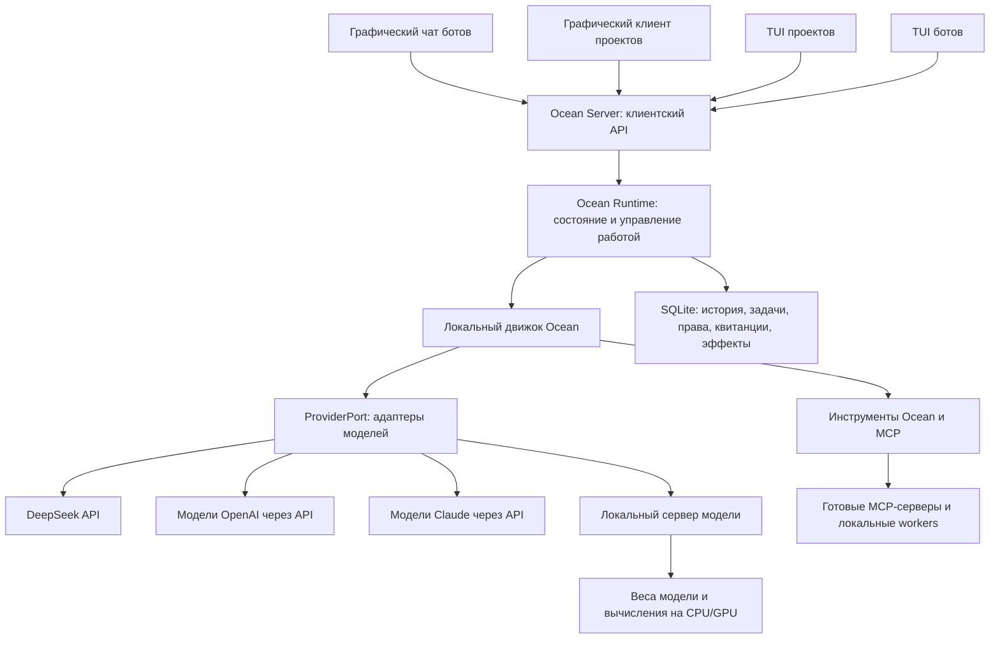

# Ocean: runtime, локальный движок и четыре клиента

Дата состояния: 2026-11-05. **Архитектурное направление принято пользователем;
реализованные и запланированные этапы разделены ниже.**

Состояние реализации: [этап A принят](platform-stage-a.md) на `1a99fcb`,
[этап B — подключения и модели](platform-stage-b.md) принят на `67a7833`
с явно указанными пределами native/live-приёмки. Прямой MCP, долговечные права,
автономные поручения и остальные этапы C–H остаются запланированными. Stable 1.1
ещё не принят; catalog/format-долг C и выпускные проверки F открыты.

Этот документ определяет текущие продуктовые приоритеты. Он уточняет
[дизайн автономности](../superpowers/specs/2026-11-04-ocean-autonomy-mcp-design.md)
и заменяет прежнюю последовательность завершения stable. Исторические записи
Ocean 1.0 и RC2 сохраняют силу только для своих ревизий и артефактов.
[План перехода](../superpowers/plans/2026-11-04-ocean-platform.md).

## 1. Продукт и приоритеты

| Результат                                            | Приоритет | Граница поставки                                                               |
| ---------------------------------------------------- | --------- | ------------------------------------------------------------------------------ |
| Общий runtime, Ocean Server и локальный движок       | 1         | Один владелец профиля; самостоятельная работа без подключённого UI             |
| Графический чат ботов                                | 1         | Постоянные боты, личные/групповые комнаты, автономные задачи и общение команды |
| Графический клиент для работы с проектом, типа Codex | 2         | Задания, рабочий каталог, команды, изменения, review и применение              |
| TUI для работы с проектом, типа Codex                | Позже     | Клиент того же серверного контракта                                            |
| TUI чат ботов                                        | Позже     | Терминальный доступ к тем же ботам, комнатам и задачам                         |

Четыре приложения означают четыре клиентских сценария, а не четыре runtime,
базы или реализации агентного цикла. Существующие TUI поддерживаются для
совместимости и диагностики; их новое оформление не блокирует приоритет 1.
Способ упаковки двух графических клиентов определяется на этапе приоритета 2:
сейчас не создаём вторую Electron-оболочку ради названия приложения.

## 2. Принятая схема

**Последнее уточнение владельца:** Codex/Claude нужны как модели, а не как
CLI-исполнители. В терминах реализации это провайдеры моделей OpenAI и Anthropic.
Ocean не запускает `codex app-server`, `codex exec`, Claude Code или ACP-агента
для выполнения своих ходов. API Ocean Server не обязан повторять протокол Codex.
У Codex app-server заимствуется идея отделения клиента от сервера.

Исследованные OpenBot/OpenMausBot используют другой путь — готовые агентные
движки. Их очереди, квитанции и разделение UI/host полезны как ориентир;
CLI-драйверы и второй управляющий агентный цикл в принятый план не входят.
MCP связывает движок с инструментами, ProviderPort — с моделями: эти роли различны.

## 3. Владение и границы

- **Ocean Server** — транспорт и проверка запросов клиентов. Для первой поставки
  приватный Unix-сокет Linux с проверкой профиля и совместимости. Это часть
  процесса runtime, не второй владелец SQLite и не обязательный сетевой сервер.
- **Runtime** владеет ботами, комнатами, задачами, очередью, полномочиями,
  квитанциями и восстановлением. Запуск, статус и остановка явные. Отключение
  клиента, отмена задачи и остановка runtime — разные операции.
- **Локальный движок Ocean** ведёт цикл модель → tools → модель, контекст,
  ограничения и остановку через сервисы runtime. Он не открывает собственный
  профиль. Начальная реализация — существующие application `runTurn`, `modelRound`
  и `executeTools`. Один и тот же цикл работает с облачными и локальными моделями.
- **Локальный сервер модели** загружает веса и вычисляет ответы на CPU/GPU.
  Это отдельный компонент вычисления модели, не второй управляющий runtime Ocean.
  Ocean подключается к его API через адаптер; собственный формат весов и
  собственную систему вычисления моделей не разрабатываем.
- **Провайдер** переводит один запрос модели и поток ответа в общий контракт.
  Модель предлагает tool calls; допускает и исполняет их Ocean. Провайдер
  не управляет комнатами, не выдаёт права и не имеет собственного scheduler задач.
- **Клиенты** получают состояние и отправляют команды через один версионированный
  контракт. Они не открывают базу, не вызывают модель и не подтверждают себя.
- **Адаптеры** выполняют I/O. Domain чистый; application зависит только от domain;
  пакеты используются через публичные entry points. TypeScript строгий,
  исходный файл не превышает 300 физических строк.

Авторизация моделей принадлежит runtime и существующему secret store. Интерфейс
показывает подключение, проверку, выбор модели и отключение, но не возвращает ключ.
Для облачных API поддерживаем явно предоставленные credentials. Локальное
подключение может работать без ключа, если так настроен выбранный сервер;
отсутствие ключа у такого подключения не означает, что модель отключена.
Подписка ChatGPT или
Claude не объявляется доступом к API; импорт логина/секретов чужого CLI не входит
в поставку. Иные способы входа требуют отдельного проверенного публичного API.
Конкретные модели, endpoints и возможности фиксируются при реализации адаптера,
по актуальной документации поставщика; одинаковая поддержка vision не предполагается.

### Облачные, локальные и смешанные команды

Поддержка локальных моделей входит в приоритет 1. Первая поставка подключается
к уже установленному локальному серверу с заранее доступной моделью; скачивание
весов, установка сервера и его автоматическое обновление — отдельные будущие функции.
Конкретный backend и модель выбираются и квалифицируются на целевом ноутбуке
в этапе B плана, с измерением RAM/VRAM, времени ответа и поддерживаемых инструментов.

У каждого бота сохраняется собственная привязка `connectionId` + `modelId`.
Одна комната может одновременно содержать облачных и локальных ботов; они
используют общие сообщения, задачи, квитанции и правила делегирования.
Каждый ход фиксирует снимок подключения/модели, а не читает изменяемую глобальную
настройку на каждом шаге. Ротация одного подключения не переключает остальных ботов.

Runtime проверяет capabilities конкретной модели: tools, изображения, streaming,
контекст и сведения об usage. Локальность не доказывает поддержку этих функций.
Недостающая возможность даёт явный отказ до неподдерживаемого запроса, а не
тайное переключение на облако. Неизвестный usage не записывается как нулевой:
для локальной модели нужны явная доступность метрики и независимые лимиты
времени/числа запросов; точный учёт и оценка различаются в контракте.

Локальный сценарий работает без интернета при уже доступных весах и локальных
инструментах. Подключение облачного бота и внешнего MCP требует соответствующей
сети. «Локальный бот» не означает приватность всей смешанной комнаты: сообщение
облачному участнику передаётся его провайдеру. Интерфейс показывает тип
подключения; комнаты с запретом облачной передачи не допускают облачного участника
или делегирование ему. Самовольного cloud fallback нет, включая сбой локального сервера.

## 4. Что сохраняем и что меняем

Снимок для карты: `codex/ocean11-stable`, HEAD `438338b`. Это чтение кода,
не новая полная квалификация установленного приложения.

| Область        | Существующая основа                                                         | Решение                                                                                                 |
| -------------- | --------------------------------------------------------------------------- | ------------------------------------------------------------------------------------------------------- |
| Сервер         | `apps/cli/src/local-runtime/host.ts`, `server.ts`, `turns.ts`, `observe.ts` | Сохраняем процесс и транспорт; расширяем общие операции, без второго сервера                            |
| Состояние      | `packages/domain`, `application/service.ts`, `store-sqlite`                 | Сохраняем TaskRun/attempt, атомарные квитанции и журнал; новые задачи связывают эти записи              |
| Движок         | `application/turn.ts`, `round.ts`, `tool-round.ts`, `types.ts`              | Сохраняем работающий цикл; отделяем настройки и композицию от клиентских сценариев                      |
| Модели         | `application/provider.ts`, `provider-core`, `provider-deepseek`             | Сохраняем ProviderPort и DeepSeek; добавляем OpenAI/Anthropic API и адаптер локальных моделей           |
| Подключения    | `application/provider-connections.ts`, `local-runtime/provider-settings.ts` | Отдельная привязка подключения/модели каждого бота; cloud/local, secret store и правила ротации         |
| Диалоги        | `direct-chat*.ts`, `chat-turn-execution.ts`, `room-broadcast.ts`            | Сохраняем admission, историю и публикацию; добавляем очередь адресованных поручений                     |
| Автономность   | coding approvals, plugin grants                                             | Постоянные доверенные области; автоматический допуск внутри них вместо окна на каждое действие          |
| Команда        | Комнаты, участники, конечная рассылка                                       | Добавляем bot-to-bot сообщения, делегирование и продолжение; рассылка остаётся отдельной командой       |
| Конкурентность | Room-busy и общий hold журнала                                              | Переходим к очереди задачи и блокировке затронутого ресурса, сохраняя порядок истории                   |
| Интеграции     | `integrations-executor`, GitHub manifest                                    | Прямой MCP SDK и конфигурация готовых серверов; снимаем привязку общего подключения к двум GitHub tools |
| Desktop        | `apps/desktop`, текущие вложения и подключение runtime                      | Развиваем в основной чат ботов; переиспользуем историю, изображения и карточки файлов                   |
| Работа с кодом | worktree, changeset, sandbox, review/apply                                  | Сохраняем сервисы и гарантии; отдельный графический сценарий — приоритет 2                              |
| TUI/ACP        | `apps/cli/src/ocean/tui.ts`, `apps/cli/src/acp`                             | Совместимость сохраняем; новый UX позже. ACP-host не превращаем в запуск внешнего движка                |
| Эксплуатация   | backup/restore, rebind/device identity, упаковка и rollback                 | Сохраняем исправления и доказательства; повторяем приёмку изменившихся путей на финальной ревизии       |

## 5. Автономность и команда

Владелец задаёт доверенную область: боты, комнаты/проекты, инструменты,
подключения, разрешённые действия и лимиты. Внутри неё bypass permissions
означает работу без пооперационных вопросов. Проверки доступа, изоляция и запись
перед внешним эффектом остаются. Модель не создаёт owner grant.

Боты могут адресовать сообщения и поручать работу друг другу без обязательного
участия человека. SQLite сохраняет доставку до пробуждения получателя; автор
определяется runtime. Ответ возобновляет исходную задачу, ожидание освобождает
исполнительный слот. Нет обязательного бота-начальника или LLM-router.
Дочерняя задача не расширяет разрешения родителя и получателя; общий бюджет,
защита от циклов и явная остановка относятся ко всей цепочке работы.

Неизвестный внешний эффект не повторяется автоматически. Отмена подтверждается
доказательствами, а не закрытием клиента или выходом главного процесса. Блокировка
по ресурсу не снимает консервативный hold старых claims с неизвестной областью.
Старые права не становятся широкими при миграции. Review точного changeset
сохраняет запрет команд и записи; обмен сообщениями роли review разрешён.

## 6. Поставка и доказательства

Первая новая поставка объединяет приоритет 1: runtime/server, собственный движок,
графический чат ботов, облачные и локальные модели, доверенные области, MCP
и смешанные команды.
Она работает с DeepSeek и локальной моделью без установленного Codex/Claude CLI. Новые API-адаптеры
проверяются отдельно; отсутствие credentials не превращает пропуск в прохождение.

Обязательны межпроцессные проверки потери квитанции, закрытия клиента, рестарта,
двух клиентов, отзыва прав, делегирования и аварии после записи начала эффекта.
На Linux x86_64/Omarchy квалифицируются настоящие GUI, sandbox, установка,
обновление/откат и живые провайдеры. `pnpm check`, `pnpm build`,
`pnpm format:check` остаются воротами, а не заменой native/live проверки.

Дополнительные обязательные gates: реальная локальная модель без интернета;
смешанная цепочка облачный A → локальный B → облачный A с сохранением run/delivery
идентичности; restart с разными привязками ботов; недоступный локальный сервер
без облачного fallback; отказ неподдерживаемых tools/изображений и запрета
передачи в облако. Отдельно измеряются ресурсы локальной модели, а не только sandbox.

Развитие приоритета 2 и новых TUI не блокирует поставку приоритета 1.
Расписания, сетевой multi-user сервер, marketplace, универсальный OAuth и
CLI-движки не включаются скрыто. Выпущенный 1.0 и установленный RC2 сохраняются;
новая архитектура не означает, что они уже обновлены или что stable 1.1 принят.
