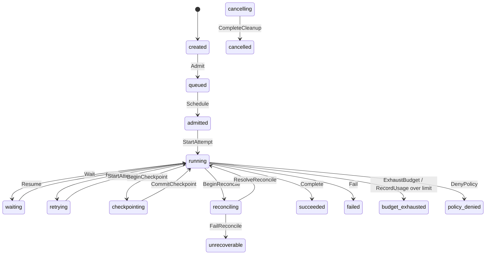
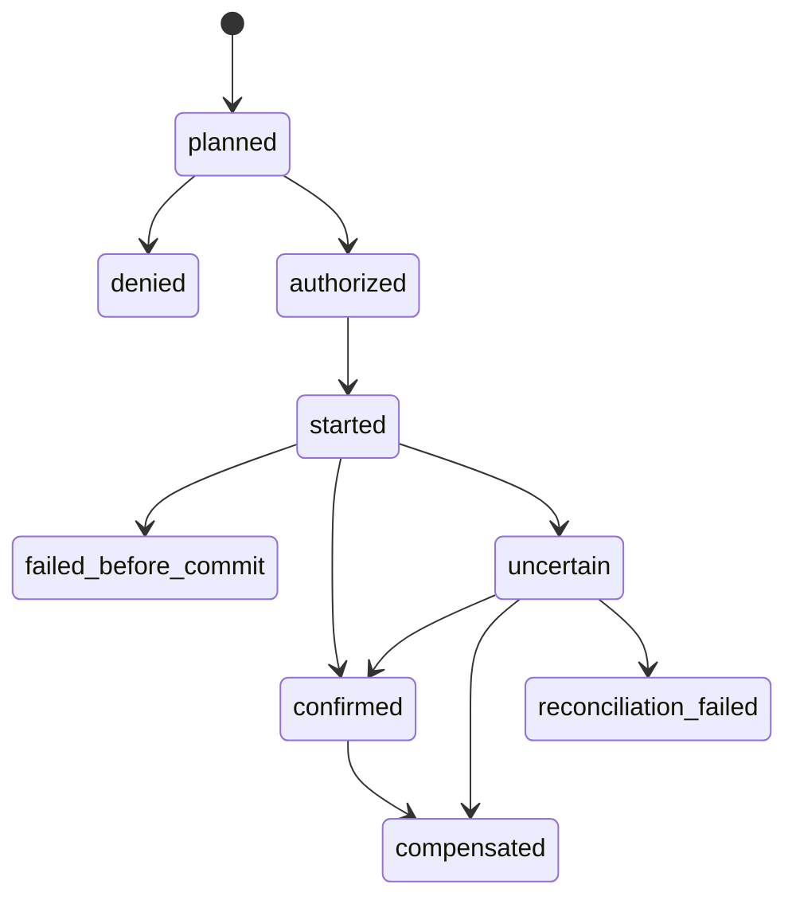

# State machines

State is a pure function of committed events. Commands are validated against a
transition table, produce event drafts, and only committed events change state.
The authoritative tables are in
[state.ts](../packages/domain/src/state.ts) (`COMMAND_SOURCES`,
`TERMINAL_STATUSES`) and [side-effect.ts](../packages/domain/src/side-effect.ts)
(`SIDE_EFFECT_TRANSITIONS`).

## 1. Decision order

`decide` ([decide.ts](../packages/domain/src/decide.ts)) applies checks in this
order, which determines the error a caller sees:

1. **Terminal immutability** — a terminal run rejects every command with
   `terminal_state`, before any version comparison.
2. **Expected version** — a mismatch is `version_conflict`.
3. **Transition table** — an illegal source state is `invalid_transition`.
4. **Payload validation** — invalid input is `invalid_argument` or
   `invariant_violation`.

`TaskRunService.execute` runs duplicate-command detection before loading the
stream, so a retried `commandId` returns its receipt instead of failing on a
stale version. The order is: dedup → load → replay → decide → append → receipt.

## 2. TaskRun lifecycle

`RequestCancel` additionally moves every non-terminal state to `cancelling`
(see the table below); it is omitted from the diagram to keep it readable.

| Command            | Source states            | Committed event                  | Resulting status   |
| ------------------ | ------------------------ | -------------------------------- | ------------------ |
| `CreateTaskRun`    | absent only              | `task_run.created`               | `created`          |
| `Admit`            | `created`                | `task_run.queued`                | `queued`           |
| `Schedule`         | `queued`                 | `task_run.admitted`              | `admitted`         |
| `StartAttempt`     | `admitted`, `retrying`   | `attempt.started`                | `running`          |
| `RecordUsage`      | `running`                | `attempt.usage_recorded`         | `running`          |
| `Wait`             | `running`                | `task_run.waiting`               | `waiting`          |
| `Resume`           | `waiting`                | `task_run.resumed`               | `running`          |
| `Retry`            | `running`                | `attempt.retry_scheduled`        | `retrying`         |
| `BeginCheckpoint`  | `running`                | `task_run.checkpointing`         | `checkpointing`    |
| `CommitCheckpoint` | `checkpointing`          | `checkpoint.committed`           | `running`          |
| `BeginReconcile`   | `running`                | `task_run.reconciling`           | `reconciling`      |
| `ResolveReconcile` | `reconciling`            | `task_run.reconciled`            | `running`          |
| `FailReconcile`    | `reconciling`            | `task_run.reconciliation_failed` | `unrecoverable`    |
| `RequestCancel`    | every non-terminal state | `task_run.cancelling`            | `cancelling`       |
| `CompleteCleanup`  | `cancelling`             | `task_run.cancelled`             | `cancelled`        |
| `Complete`         | `running`                | `task_run.succeeded`             | `succeeded`        |
| `Fail`             | `running`                | `task_run.failed`                | `failed`           |
| `ExhaustBudget`    | `running`                | `task_run.budget_exhausted`      | `budget_exhausted` |
| `DenyPolicy`       | `running`                | `task_run.policy_denied`         | `policy_denied`    |

Command names and event names are not symmetric: `Admit` emits
`task_run.queued` and `Schedule` emits `task_run.admitted`. The table is
authoritative; read names from it.

`COMMAND_SOURCES.CreateTaskRun` is an empty list on purpose. Creation is not a
transition out of a status, so `decide` special-cases the absent aggregate and
accepts `CreateTaskRun` only there.

## 3. Terminal states

`succeeded`, `failed`, `cancelled`, `budget_exhausted`, `policy_denied` and
`unrecoverable` are terminal (`TERMINAL_STATUSES`, `isTerminal`). A terminal run
commits no further events through `decide`. `evolve` records the outcome in
`terminal`:

| Event                            | `terminal.status`  | `terminal.failure` | `terminal.summary`         |
| -------------------------------- | ------------------ | ------------------ | -------------------------- |
| `task_run.succeeded`             | `succeeded`        | `null`             | payload summary            |
| `task_run.failed`                | `failed`           | payload failure    | `null`                     |
| `task_run.cancelled`             | `cancelled`        | `null`             | `completed` or `forced`    |
| `task_run.budget_exhausted`      | `budget_exhausted` | `null`             | `dimension:consumed/limit` |
| `task_run.policy_denied`         | `policy_denied`    | `null`             | `capability:reason`        |
| `task_run.reconciliation_failed` | `unrecoverable`    | payload failure    | `null`                     |

## 4. Attempts and retries

- `StartAttempt` is legal from `admitted` and `retrying`. The committed ordinal
  is `attemptCount + 1`, so attempts are numbered consecutively and each
  `attempt.started` replaces `activeAttempt` and clears `waitingReason`.
- `Retry` is legal from `running`. It requires a finite non-negative
  `delayMs` and a `dueAt` matching ISO-8601 UTC
  (`YYYY-MM-DDTHH:MM:SS[.sss]Z`); it commits `attempt.retry_scheduled` with
  `nextOrdinal = attemptCount + 1` and moves the run to `retrying`.
- A retry is a new attempt record, not a second execution of the same attempt.
  `AttemptReason` distinguishes `initial`, `retry`, `resume` and `reconcile`.
- `Complete` and `Fail` (when `attemptId` is present) require the referenced
  attempt to be the active one; otherwise the command fails with
  `invariant_violation`.
- `Fail` accepts `attemptId: null`, which records a failure that is not tied to
  a specific attempt.

## 5. Checkpoints

- `BeginCheckpoint` requires a non-empty `checkpointId`, moves to
  `checkpointing`, and stores it as `pendingCheckpointId`.
- `CommitCheckpoint` requires the same id and an integer `eventPosition` in
  `1..version`, so a checkpoint can only reference an already committed
  position. It clears the pending id and records `lastCommittedCheckpointId`.
- Committing a mismatched id or an uncommitted position is rejected; the run
  stays in `checkpointing`.
- No snapshot storage exists: checkpoints are lifecycle events that point at a
  stream position.

## 6. Waiting

`Wait` is legal only from `running` and records a typed `WaitingReason`:
`approval`, `retry_delay`, `child_result`, `tool_process`, `external_input`,
`resource_capacity`, `reconciliation`. `Resume` is legal only from `waiting`
and clears the reason. Nothing in this repository decides when a wait ends; an
external caller submits `Resume`.

## 7. Cancellation

Cancellation is two-phase so that a forced stop stays visible:

1. `RequestCancel` from any non-terminal state commits `task_run.cancelling`
   with a cause and enters `cancelling`.
2. `CompleteCleanup` commits `task_run.cancelled` with `cleanup` set to
   `completed` or `forced`, entering the terminal `cancelled` state.

A run in `cancelling` cannot be completed, resumed or cancelled again. A
`cancelled` run is terminal, so a late command is rejected with
`terminal_state`.

## 8. Reconciliation

- `BeginReconcile` is legal from `running` and records its reason; the run
  enters `reconciling`.
- `ResolveReconcile` returns it to `running`.
- `FailReconcile` records `FailureInfo` and moves the run to the terminal
  `unrecoverable` state.

Recovery after a crash is not implemented in this repository: there is no
startup scan, no checkpoint load and no reconciliation driver. The state
machine only defines the states such a driver would use.

## 9. Side-effect machine

Rules enforced by [side-effect.ts](../packages/domain/src/side-effect.ts):

- `denied` and `failed_before_commit` are terminal without an external commit.
- `uncertain` requires reconciliation; `retryVerdict` returns
  `requires_reconciliation`, never `safe`.
- `confirmed` and `compensated` are terminal. Compensation adds a new record;
  the confirmed effect remains in history.
- `reconciliation_failed` keeps the uncertainty instead of resolving it.
- Only `failed_before_commit` is safe to retry (`retryVerdict` → `safe`).

The machine is a pure model here: no invocation or effect events exist yet.

## 10. Budget operations

Budgets are `{ limits, consumed, reserved }` snapshots. The arithmetic lives in
[budget.ts](../packages/domain/src/budget.ts):

| Operation                      | Effect                                           | Rejected when                                        |
| ------------------------------ | ------------------------------------------------ | ---------------------------------------------------- |
| `reserve(budget, dim, amount)` | Moves capacity into `reserved`                   | Amount not finite/non-negative, or above `available` |
| `settle(budget, dim, actual)`  | Adds to `consumed`, clears that much reservation | Actual above reserved; non-finite/negative           |
| `release(budget, dim, amount)` | Reduces `reserved` only                          | Amount above reserved; non-finite/negative           |
| `consume(budget, dim, amount)` | Adds to `consumed` without a reservation         | Non-finite/negative                                  |

`available = limit - consumed - reserved` (infinite when the limit is `null`);
`isExhausted` reports the first dimension where `consumed >= limit`.

Usage settlement is evented for provider tokens: `RecordUsage` commits
`attempt.usage_recorded`, and `evolve` adds `totalTokens` to
`consumed.provider_tokens` monotonically. When a finite `provider_tokens` limit
is crossed, the same decision also commits `task_run.budget_exhausted` and the
run becomes terminal. Other dimensions (cost, active time, tools, retries,
children, processes) are still reset by replay to their creation values; the
reserve/settle/release helpers are not yet driven by committed events.

A turn must settle usage before it succeeds, fails or cancels: the host commits
`RecordUsage` first, so a budget overrun is durable even when the turn itself
fails.

## 11. Concurrency and conflicts

| Situation                   | Behaviour                                                                                                                   |
| --------------------------- | --------------------------------------------------------------------------------------------------------------------------- |
| Duplicate `commandId`       | Stored receipt is returned; nothing is appended                                                                             |
| Stale `expectedVersion`     | `version_conflict` before any decision                                                                                      |
| Concurrent writers          | `append` compares the expected version; the loser commits nothing and receives `version_conflict` with the observed version |
| Command after terminal      | `terminal_state`                                                                                                            |
| Illegal source state        | `invalid_transition`                                                                                                        |
| Two `StartAttempt` in a row | Second is rejected: source state is `running`, not `admitted`/`retrying`                                                    |
| Replayed event stream       | `replay` throws if creation is missing or duplicated                                                                        |

## 12. Invariants

| Invariant                                  | Enforced by                                                           |
| ------------------------------------------ | --------------------------------------------------------------------- |
| Transitions only through committed events  | `decide` returns drafts; only `append` commits                        |
| Expected-version fencing                   | `decide` version check and `EventLogPort.append`                      |
| Terminal state immutable                   | `decide` first check                                                  |
| One active attempt                         | `requireRunningAttempt`; `attempt.started` overwrites `activeAttempt` |
| Checkpoint references a committed position | `CommitCheckpoint` validation                                         |
| Cancellation is explicit                   | `RequestCancel` → `CompleteCleanup`                                   |
| Budget consumption monotonic               | `settle`/`consume` only add; `release` touches reservations           |
| Uncertain effects never auto-retry         | `retryVerdict`                                                        |
| Confirmed effects not rewritten            | `confirmed` is terminal; compensation is a new state                  |
